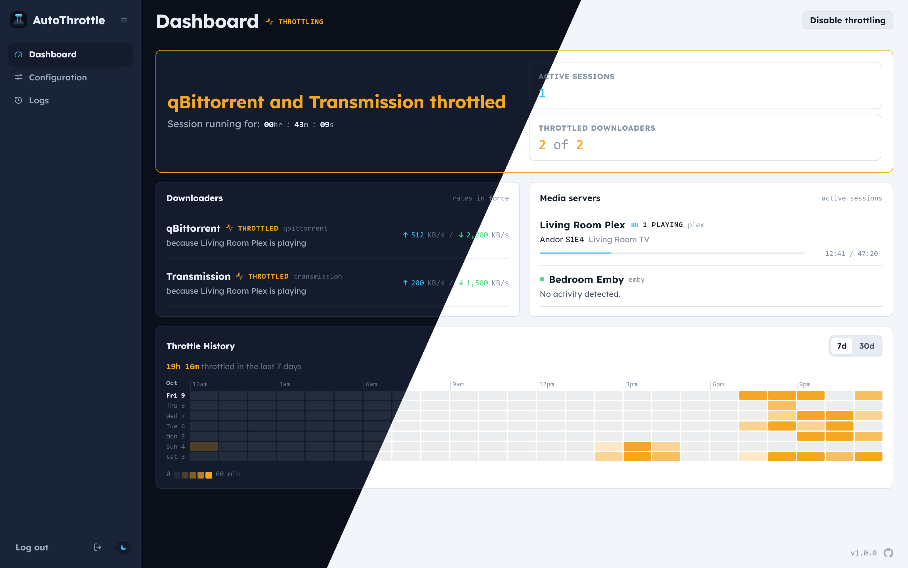
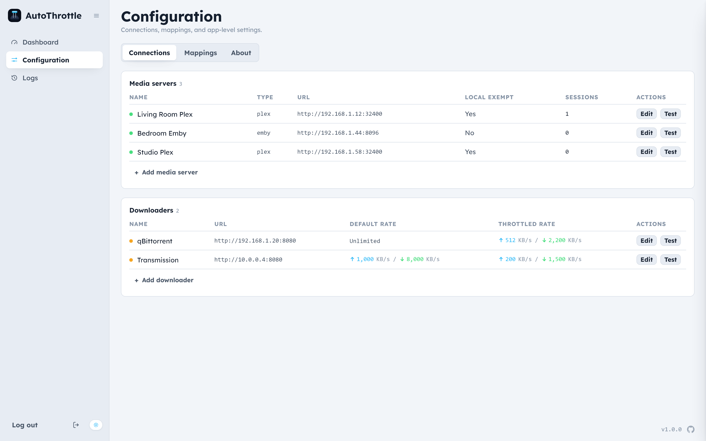
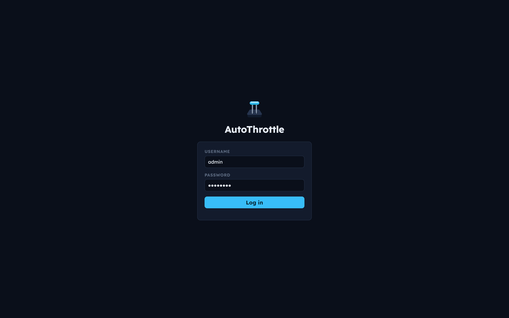
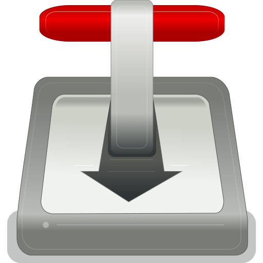
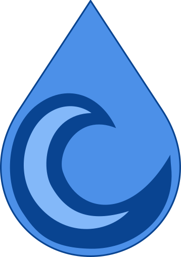

<p align="center">
  
</p>

<h1 align="center">AutoThrottle</h1>

<p align="center">
  <strong>Intelligently throttles download clients while a media server has active playback.</strong>
</p>

<p align="center">
  <a href="https://github.com/JaiMistry/autothrottle/actions/workflows/ci.yml"></a>
  <a href="https://codecov.io/gh/JaiMistry/autothrottle"></a>
  <a href="https://github.com/JaiMistry/autothrottle/releases/latest"></a>
  <a href="https://hub.docker.com/r/jaimistry/autothrottle"></a>
  <a href="https://hub.docker.com/r/jaimistry/autothrottle"></a>
  <a href="https://ca.unraid.net/apps/autothrottle-0xufrs017fz9b0"></a>
</p>

AutoThrottle slows your download clients while playback is detected on your media server, and reverts them back to their normal speeds once playback ends. It utilizes the server's live feed so changes are detected in near real time. AutoThrottle is also pause- and autoplay-aware, ensuring that rate changes don't flip your downloads back on between episodes, and a paused stream reverts to default rates after a timeout. In addition, streams on your own network can be left out entirely. Throttling can also be globally toggled on or off when needed.

<p align="center">
  
</p>
<p align="center">
  
  
</p>

## ⭐ Features

- **Live dashboard:** A modern reactive UI with live updates as they occur.
- **Near-real-time detection:** Listens to each server's live feed.
- **Autoplay-aware:** Back-to-back episodes being played will hold throttling, preventing unnecessary rate changes.
- **Pause-aware:** A paused stream stays throttled until a 30-minute timeout.
- **Local playback exemption:** Streams on your own network can be ignored, so only remote connections count.
- **Mappings:** Control which media servers throttle which download clients.
- **Restart/crash-safe:** Rates are reapplied on startup, so nothing stays stuck slow.
- **Throttle history:** A 7- and 30-day heatmap of when your downloads were held back.
- **Secure:** All sensitive credentials are securely encrypted and never leaked.
- **Lightweight:** A single distroless image with a minimal footprint.
- **Runs anywhere:** Docker on amd64 and arm64, Unraid Community Apps, and as a native Windows service.

<details>
<summary><strong>How AutoThrottle decides when to throttle</strong></summary>

<br>

**What counts as watching.** A stream counts while it is playing, buffering or paused on a media server you've added and mapped to a download client. With the local playback exemption on, streams from your own network don't count, so only the ones using your internet connection do.

**How fast it notices.** AutoThrottle doesn't poll on a timer. It holds a live connection to each server: Plex's notification socket, and the session feed Jellyfin and Emby push every 1.5 seconds. A press of play reaches it within a second or two. Every 60 seconds it also re-reads each server's full session list, to catch anything the live feed missed.

**What it changes.** While any server mapped to a download client has a stream that counts, that client runs at the throttled rates you gave it. When none does, it goes back to its default rates. A download client is only contacted when that answer changes, so a stream's timecode ticking along costs it nothing.

**Pauses.** A paused stream stays throttled, since the viewer is usually coming back. But servers keep paused sessions open for hours, and Jellyfin can show a closed player as still playing, so a stream that hasn't moved for 30 minutes stops counting until it moves again. That clock survives a restart of AutoThrottle.

**Between episodes.** When a TV episode ends in its closing stretch (the last 5 minutes, or the last tenth for a long one), autoplay's next episode may start a few seconds later. So the throttle holds for 30 seconds instead of lifting, and the Dashboard says it's waiting on the next episode. If the next one starts, nothing changes; if it doesn't, default rates return when the 30 seconds are up. There's no hold after a film, an episode stopped partway, or a show's last episode, because nothing would autoplay after them.

**When something goes wrong.** If a download client can't be reached, AutoThrottle keeps retrying, sooner at first and then every couple of minutes, and applies the right rates as soon as it answers. When AutoThrottle restarts, it re-applies whatever should be in force. Every throttle and restore is logged with what caused it.

**Overriding it.** Disable throttling puts every client back to its default rates straight away and keeps them there, even across restarts, until you resume. On Windows, Exit in the tray icon also restores default rates before AutoThrottle stops.

</details>

## 🧩 Supported versions

| | Media server | Version |
|:-:|---|---|
| <a href="https://www.plex.tv"></a> | Plex Media Server | 1.43+ |
| <a href="https://jellyfin.org"></a> | Jellyfin | 10.11+ |
| <a href="https://emby.media"></a> | Emby | 4.9+ |

| | Download client | Version |
|:-:|---|---|
| <a href="https://www.qbittorrent.org"></a> | qBittorrent | 5.2+ |
| <a href="https://transmissionbt.com"></a> | Transmission | 4.1+ |
| <a href="https://deluge-torrent.org"></a> | Deluge (coming soon) | 2.1+ |

## 🚀 Quick start

### Docker Compose

```yaml
services:
  autothrottle:
    image: jaimistry/autothrottle:latest
    container_name: autothrottle
    environment:
      - PUID=1000
      - PGID=1000
      - TZ=America/Los_Angeles
    volumes:
      - /data:/data
    ports:
      - "7676:7676"
    restart: unless-stopped
```

### Docker run

```sh
docker run -d \
  --name autothrottle \
  -e PUID=1000 \
  -e PGID=1000 \
  -e TZ=America/Los_Angeles \
  -v /data:/data \
  -p 7676:7676 \
  --restart unless-stopped \
  jaimistry/autothrottle:latest
```

### Windows

Download and run `AutoThrottle-Setup-<version>.exe` from the [latest release](https://github.com/JaiMistry/autothrottle/releases/latest).

## ⚙️ Environment variables

All are optional.

| Variable | Default | What it does |
|---|---|---|
| `TZ` | `America/Los_Angeles` | Time zone for timestamps. |
| `PUID` | `1000` | User that owns the data folder. |
| `PGID` | `1000` | Group that owns the data folder. |
| `AUTH_USERNAME` | | Sign-in username from the environment instead of creating an account. Set with `AUTH_PASSWORD`. |
| `AUTH_PASSWORD` | | Sign-in password from the environment. Set with `AUTH_USERNAME`. |
| `AUTH_DISABLED` | `false` | Turns off sign-in. Only use this behind a proxy that handles it. |

## 🛠️ First-time setup

Open `http://<your-server>:7676` and create your account. Everything else
happens on the **Configuration** page:

1. **Add a media server** with its URL and token or API key. For Plex you can
   sign in with your Plex account instead of pasting a token.
2. **Add a download client** with two pairs of rates:
   - **Default rates**, applied when nothing is playing.
   - **Throttled rates**, applied while a mapped server is playing.

   Rates are in KB/s, and `0` means unlimited.
3. **Map them.** Choose which media servers throttle which download clients.

## License

[GPL-3.0](LICENSE)

<p align="center"><sub>Made with ❤️ by <a href="https://github.com/JaiMistry">JaiMistry</a></sub></p>
